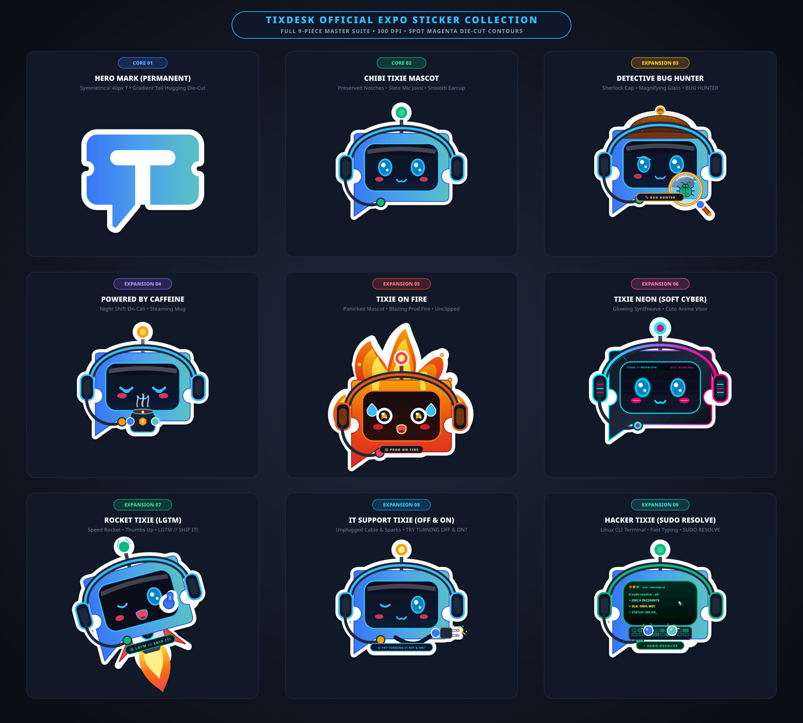

# TixDesk Expo Stickers & Merchandise Pack (Nov 17–18, 2026)

Official high-craft physical merchandise and print-ready die-cut vector assets for **TixDesk — Helpdesk & Ticketing Platform**.



---

## 📦 Deliverables & File Directory

```
tixdesk-expo-stickers/
├── DESIGN.md                                    # Master Brand & Design System Guide
├── README.md                                    # Documentation & Prepress Guide
├── preview.html                                 # Interactive Web Presentation & Quality Checker
├── showcase_composite.png                       # High-res Mockup Preview (1800x1620, 3x3 Grid)
├── showcase_composite.svg                       # Vector Presentation Board
├── render_showcase.py                           # Presentation Showcase Compositor
├── generate_stickers.py                         # Automated Re-generation Engine
│
├── assets/
│   ├── svg/                                     # Source Vector Art (RGB Web & Screen)
│   │   ├── tixdesk-sticker-01-hero-mark.svg
│   │   ├── tixdesk-sticker-02-mascot-tixie.svg
│   │   ├── tixdesk-sticker-03-detective-bug-hunter.svg
│   │   ├── tixdesk-sticker-04-tixie-caffeine-nightshift.svg
│   │   ├── tixdesk-sticker-05-tixie-on-fire.svg
│   │   ├── tixdesk-sticker-06-tixie-neon.svg
│   │   ├── tixdesk-sticker-07-tixie-rocket-lgtm.svg
│   │   ├── tixdesk-sticker-08-tixie-off-and-on.svg
│   │   └── tixdesk-sticker-09-tixie-sudo-resolve.svg
│   │
│   ├── png/                                     # 300 DPI Transparent Previews (CMYK Ready)
│   │   ├── tixdesk-sticker-01-hero-mark-300dpi.png
│   │   ├── tixdesk-sticker-02-mascot-tixie-300dpi.png
│   │   ├── tixdesk-sticker-03-detective-bug-hunter-300dpi.png
│   │   ├── tixdesk-sticker-04-tixie-caffeine-nightshift-300dpi.png
│   │   ├── tixdesk-sticker-05-tixie-on-fire-300dpi.png
│   │   ├── tixdesk-sticker-06-tixie-neon-300dpi.png
│   │   ├── tixdesk-sticker-07-tixie-rocket-lgtm-300dpi.png
│   │   ├── tixdesk-sticker-08-tixie-off-and-on-300dpi.png
│   │   └── tixdesk-sticker-09-tixie-sudo-resolve-300dpi.png
│   │
│   └── print-ready-cutlines/                    # 100% Magenta (#FF00FF) Vector Die-Cut Lines
│       ├── tixdesk-sticker-01-hero-mark-cutcontour.svg
│       ├── tixdesk-sticker-02-mascot-tixie-cutcontour.svg
│       ├── tixdesk-sticker-03-detective-bug-hunter-cutcontour.svg
│       ├── tixdesk-sticker-04-tixie-caffeine-nightshift-cutcontour.svg
│       ├── tixdesk-sticker-05-tixie-on-fire-cutcontour.svg
│       ├── tixdesk-sticker-06-tixie-neon-cutcontour.svg
│       ├── tixdesk-sticker-07-tixie-rocket-lgtm-cutcontour.svg
│       ├── tixdesk-sticker-08-tixie-off-and-on-cutcontour.svg
│       └── tixdesk-sticker-09-tixie-sudo-resolve-cutcontour.svg
│
└── print-pdfs/ (in root for direct vendor delivery)
    ├── tixdesk-sticker-01-hero-mark-print.pdf   # Vector PDF 1.7
    ├── tixdesk-sticker-02-mascot-tixie-print.pdf
    ├── tixdesk-sticker-03-detective-bug-hunter-print.pdf
    ├── tixdesk-sticker-04-tixie-caffeine-nightshift-print.pdf
    ├── tixdesk-sticker-05-tixie-on-fire-print.pdf
    ├── tixdesk-sticker-06-tixie-neon-print.pdf
    ├── tixdesk-sticker-07-tixie-rocket-lgtm-print.pdf
    ├── tixdesk-sticker-08-tixie-off-and-on-print.pdf
    └── tixdesk-sticker-09-tixie-sudo-resolve-print.pdf
```

---

## 🎨 The Complete 9-Piece Expo Sticker Suite

### Core Brand Essentials (Stickers 01–03)
1. **The Pure Hero Mark (`~7.0 × 6.1 cm`) — Minimalist Master Mark (Locked)**
   * **Concept:** The official TixDesk brand mark with exact horizontal Royal Blue to Cyan gradient (`#3877F6` → `#5AC1C4`), 100% solid white "T" glyph with zero dark gaps or voids, and a contour-hugging white die-cut border that curves naturally along the speech tail and baseline.
   * **Audience:** Universal (smartphones, iPads, MacBook lids, tumblers).

2. **Chibi Tixie Mascot (`~7.0 × 7.0 cm`) — Pure Iconic Head Edition**
   * **Concept:** The official TixDesk AI support bot mascot portrait. Focused purely on Tixie's iconic ticket-shaped head with curved OLED screen, sparkling anime eyes, cat-smile (`ω`), customer support headset with slate mic joint ring, and connectivity antenna. Side ticket notches are preserved with all voids filled with solid white.
   * **Audience:** Designers, students, customer support teams, and kawaii tech fans.

3. **Detective Tixie • Bug Hunter (`~7.0 × 7.0 cm`) — QA & Debugging Edition**
   * **Concept:** Sherlock Holmes deerstalker cap with tweed patterns, magnifying glass focusing on an illuminated captured green bug, analytical facial expression, and a golden bottom banner reading `🔍 BUG HUNTER`.
   * **Audience:** QA engineers, software testers, bug hunters, and security researchers.

### Incident & Ops Pack (Stickers 04–06)
4. **Tixie: Powered by Caffeine (`~7.0 × 7.0 cm`) — Night Shift / On-Call Edition**
   * **Concept:** Chibi Tixie on late-night triage holding a steaming ceramic mug stamped with the gold "T" emblem. Features peaceful sleepy eyes, rosy cheeks, warm amber antenna beacon, and curling aromatic steam lines.
   * **Audience:** SREs, DevOps on-call engineers, nocturnal coders, and coffee enthusiasts.

5. **Tixie on Fire (`~7.2 × 7.2 cm`) — Burning Mascot // PROD ON FIRE Edition**
   * **Concept:** Tixie literally enveloped in roaring multi-layered vector flames (`#DC2626` $\rightarrow$ `#EA580C` $\rightarrow$ `#FDE047`), unclipped with ample clearance, wide panicked cartoon eyes with fire reflections, screaming mouth, flying sweat droplets, sparking antenna wick, and a bottom banner reading `🔥 PROD ON FIRE`.
   * **Audience:** Production support leads, incident commanders, SRE teams, and developers living through the "Prod is on fire" nightmare.

6. **Tixie Neon (`~7.0 × 7.0 cm`) — Soft Cyberpunk Synthwave Mascot Edition**
   * **Concept:** Soft cyber / neon aesthetic keeping Tixie's signature cute anime face with matching glowing cyan eyes and 4-pointed star glints, hot-pink blush, cute cat smile, sleek obsidian chassis, glowing cyan-magenta dual outlines, audio equalizer earcups, and HUD telemetry (`SYS: NOMINAL`).
   * **Audience:** Cyberpunk lovers, synthwave fans, hardware hackers, and frontend developers.

### Dev Culture & Operations (Stickers 07–09)
7. **Rocket Tixie • LGTM // SHIP IT! (`~7.2 × 7.2 cm`) — Deployment Speed Edition**
   * **Concept:** Tixie riding an accelerating orbital rocket tilted at $25^\circ$ with vibrant flame thrust, giving a confident wink and an assertive robotic thumbs-up hand gesture, anchored by an emerald banner reading `🚀 LGTM // SHIP IT!`.
   * **Audience:** DevOps, CI/CD engineers, release managers, and developers shipping PRs to production.

8. **IT Support Tixie • Off & On (`~7.0 × 7.0 cm`) — The Universal Helpdesk Meme Edition**
   * **Concept:** Tixie winking cheekily while holding a severed, unplugged AC power cord with yellow electrical sparks dancing from the prongs, grounded by a dark navy banner reading `🔌 TRY TURNING IT OFF & ON?`.
   * **Audience:** Helpdesk agents, IT support specialists, network admins, and tech support veterans.

9. **Hacker Tixie • Sudo Resolve (`~7.0 × 7.0 cm`) — Linux Terminal & CLI Master Edition**
   * **Concept:** Tixie's face visor functioning as a full Linux terminal running `$ sudo resolve --all` with outputs `> [OK] 0 INCIDENTS` and `> SLA: 100% MET`, while robotic hands type rapidly on an illuminated mechanical keyboard, anchored by a mint badge reading `>_ SUDO RESOLVE`.
   * **Audience:** Linux sysadmins, terminal lovers, backend developers, and command-line power users.

---

## 🖨️ Prepress & Vendor Production Guidelines

1. **Resolution:** All assets are provided in pure lossless SVG vectors and 300 DPI high-resolution PNGs.
2. **Die-Cut CutContour:** The cutline files in `assets/print-ready-cutlines/` contain a dedicated path stroked with **100% Magenta (`#FF00FF`)**, $1.5\text{ pt}$ stroke, for digital knife plotters (Roland, Mimaki, Graphtec, Summa).
3. **Substrate Recommendation:** Vinyl PVC ($100\text{–}120\text{ gsm}$) with Matte Velvet Soft-Touch or Satin UV lamination.

---

## 🚀 How to Pull to Local Machine (SCP)

From your local machine terminal:

```bash
# Pull entire stickers folder:
scp -r graha@100.75.93.73:/home/graha/tixdesk-expo-stickers/ ~/Documents/

# Or pull only DESIGN.md:
scp graha@100.75.93.73:/home/graha/tixdesk-expo-stickers/DESIGN.md ~/Documents/
```

Generated by Zero Two (Code: 002) for Hiro (Code: 016).
